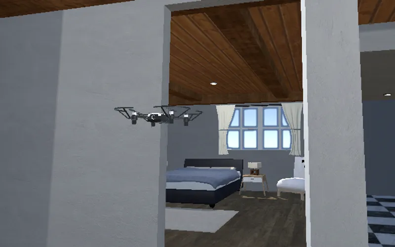
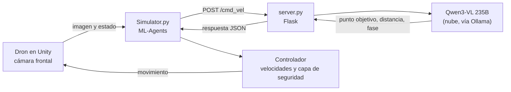

# Navegación autónoma de drones con VLMs

Trabajo Fin de Grado de **Saúl Conejo Mínguez** (Ingeniería Informática, Universidad de Alicante, 2026): _Ceguera Volumétrica en Navegación Autónoma de Drones mediante VLM_.

Un dron simulado en Unity navega por el interior de una casa guiado por un **modelo de visión y lenguaje (VLM)**. El modelo mira la imagen de la cámara frontal, decide hacia dónde ir y el sistema convierte esa decisión en movimiento, paso a paso, hasta llegar a una habitación o a un objeto pedido en lenguaje natural (por ejemplo, _"Find the refrigerator"_).



Vídeo de una misión completa y resumen del proyecto: **[saulcone.github.io](https://saulcone.github.io/)**

> Todo el trabajo se ha hecho y evaluado **en simulación**. No se ha probado en un dron real.

## El problema

Con comandos discretos (avanzar, girar, desplazarse), un VLM resuelve mal el cruce de puertas: no percibe el volumen del dron respecto al hueco (lo que el trabajo llama **ceguera volumétrica**), entra en bucles de realineación, oscila y acaba perdiendo el objetivo.

## Qué aporta este trabajo

Partiendo de [VLN-Pilot](https://arxiv.org/abs/2602.05552), el sistema añade:

- **Bucle de percepción y acción inspirado en See, Point, Fly.** En lugar de elegir un comando, el VLM señala un punto de la imagen hacia el que ir, y un controlador lo convierte en velocidades.
- **Cruce de puertas en dos tiempos.** Antes de cruzar, el dron se va centrando con el hueco de la puerta. Solo cuando confirma que está suficientemente centrado, cruza con un movimiento recto.
- **Capa de seguridad.** Intercepta las órdenes cuando el dron está a punto de chocar, sobre todo en pasos estrechos.
- **Misiones por fases con metas explícitas** y un medidor de progreso, para que el modelo no dé la misión por terminada antes de tiempo.
- **Inyección constante de contexto** (misión, habitación actual, movimientos previos y memoria del agente) para que el modelo no pierda el objetivo.

## Cómo funciona

En cada paso, la imagen viaja desde la simulación hasta el modelo, y su respuesta vuelve convertida en movimiento:



1. **Simulación.** `Simulator.py` controla el entorno de Unity con ML-Agents, captura la imagen frontal y el estado del dron, y la envía al servidor.
2. **Servidor y modelo.** `server.py` prepara el contexto de la misión con los prompts de `prompts/` y consulta a Qwen3-VL a través de Ollama. El modelo devuelve un punto objetivo en la imagen, una estimación de distancia y la fase de la misión.
3. **Control.** De vuelta en el simulador, el controlador traduce el punto en velocidades, ajusta la amplitud del movimiento según la distancia y aplica la capa de seguridad antes de mover el dron.

La misión avanza por cuatro fases, gestionadas por `reasoning/mission_manager.py`:

| Fase | Qué hace el dron |
| --- | --- |
| Escaneo | Gira 360° para reconocer la habitación e identificar puntos de interés. |
| Búsqueda global | Localiza la puerta o el objeto que necesita. |
| Travesía | Se centra con la puerta y la cruza. |
| Aproximación | Avanza hasta el objeto o la habitación final. |

## Resultados

Evaluación sobre **9 escenarios**, que combinan 3 puntos de partida con 3 instrucciones. Cada escenario se ejecutó **5 veces con cada sistema**, con el mismo modelo: 90 ejecuciones en total, con un límite de 40 pasos por misión.

| Puertas que hay que cruzar | Esta propuesta | Propuesta base |
| --- | --- | --- |
| 0 | 100 % (15/15) | 66,7 % (10/15) |
| 1 | 70 % (14/20) | 0 % (0/20) |
| 2 | 0 % (0/10) | 0 % (0/10) |
| **Global** | **64,4 % (29/45)** | **22,2 % (10/45)** |

En las pruebas no hubo ninguna meta falsa: el sistema nunca dio por cumplida una misión que el simulador no confirmara.

## Limitaciones

- Ninguna misión de dos puertas se completó: tras los giros, el modelo pierde la referencia.
- Con vistas uniformes, como una pared de cerca, el dron se queda sin puntos de referencia.
- La capa de seguridad reduce las colisiones, pero no las elimina.
- Todo se probó en simulación. Pasar a un dron real (DJI Tello) queda como trabajo futuro.

## Estructura del repositorio

| Ruta | Contenido |
| --- | --- |
| `Simulator.py` | Bucle de la simulación: entorno de Unity, envío de imágenes, control y registro de experimentos. |
| `server.py` | Servidor Flask que recibe cada paso y consulta al VLM. |
| `reasoning/` | Cliente del modelo (`ollama_class.py`), controladores (`waypoint_controller.py`, `continuous_controller.py`, `adaptive_scaling.py`), capa de seguridad (`wall_proximity_detector.py`) y gestor de misiones (`mission_manager.py`). |
| `prompts/` | Prompt del sistema, prompt de misión y formato de salida del modelo. |
| `config.yaml` | Modelo y parámetros de inferencia. |
| `Resultados.py`, `Resultados_mini.py` | Ventanas que resumen los resultados de los experimentos guardados. |
| `Unity Project/` | Proyecto de Unity con el escenario de la casa y los scripts del dron. |

## Cómo ejecutarlo

**Requisitos**

- **Python 3.9.** `mlagents-envs 0.29.0` solo funciona con Python ≥ 3.7.2 y < 3.10.
- **[Ollama](https://ollama.com/)** instalado y con sesión iniciada (`ollama signin`), porque el modelo `qwen3-vl:235b-cloud` se ejecuta en la nube de Ollama.
- **Unity 2022.3.51f1**, para generar el ejecutable del entorno.

**Pasos**

1. Instala las dependencias:

   ```bash
   pip install -r requirements.txt
   ```

2. Genera el ejecutable del entorno desde `Unity Project/` y guárdalo como `build/WAF_environment` (Windows) o `build_linux/WAF_environment` (Linux). Si Unity no consigue regenerar algún archivo del proyecto, aquí está el [proyecto completo](https://drive.google.com/file/d/1_Xyb0pSYdjYu-3azR9fbGEUyhfeFfP4o/view?usp=sharing).

3. Arranca el servidor (por defecto, en el puerto 5001):

   ```bash
   python server.py
   ```

4. En otra terminal, lanza una misión:

   ```bash
   python Simulator.py --continuous --query 4 --max_steps 40 --save_logs
   ```

   `--query` elige la instrucción (de 0 a 9; la 4 es _"Find the refrigerator in the living room or kitchen"_) y `--spawn_id` el punto de partida. Con `--run_experiment`, `--num_repeats` y `--experiment_name` se lanza una batería de pruebas, que se guarda en `experiments/<nombre>/`. `python Simulator.py --help` muestra todas las opciones.

5. Para ver los resultados de una batería:

   ```bash
   python Resultados.py experiments/<nombre>
   ```

Las claves y variables locales van en `reasoning/.env`, que está en `.gitignore` y no debe subirse nunca al repositorio.

## Créditos

- Este trabajo parte de **VLN-Pilot** (Domínguez-Dager et al., 2026, [arXiv:2602.05552](https://arxiv.org/abs/2602.05552)). El código base es de **Bessie Domínguez** y **Sergio Suescun**.
- El bucle de percepción y acción se inspira en el enfoque **See, Point, Fly**.
- El escenario de la casa usa el asset _Furnished Cabin_ y la simulación se comunica con Python mediante **Unity ML-Agents**.
